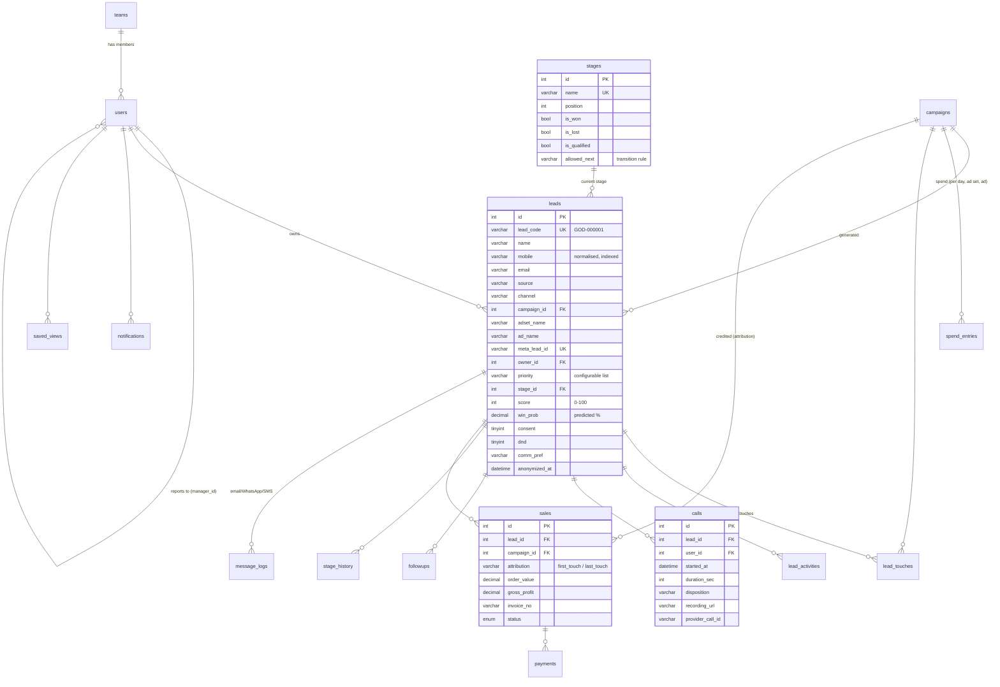

# Database schema & ER diagram (SRS §21.2)

Source of truth: [`db/schema.sql`](../db/schema.sql). `npm run db:setup` creates it and migrates older databases in place (safe to re-run).
MySQL 8 or MariaDB 10.6+, InnoDB, utf8mb4.

## Tables

| Table | Purpose |
|---|---|
| `users`, `teams` | Employees, 8 roles, hierarchy (`manager_id`, team leader), daily caps/targets, availability, phone, vertical, notification channels |
| `stages` | Configurable pipeline with won/lost/qualified flags and allowed transitions |
| `leads` | One row per customer enquiry (all SRS §4 fields + score, consent, preferences) |
| `lead_touches` | Every campaign/source touch (creation + re-enquiries) — drives first/last-touch attribution |
| `lead_activities` | Timeline: create, edit (with old→new values), notes, calls, stage, assignment, messages, system events |
| `stage_history` | Every stage change with user, time and seconds spent in the previous stage |
| `calls` | Call log (manual or telephony), disposition, duration, recording |
| `followups` | Scheduled follow-ups with assignee, outcome, reminder/escalation flags |
| `campaigns`, `spend_entries` | Campaigns (manual or Meta-synced) and daily spend (manual or Meta, per ad) |
| `sales`, `payments` | Booked sales (credited to one campaign) and payments/refunds |
| `assignment_rules` | Source/campaign/category → team/user routing |
| `notifications`, `message_logs` | In-app notifications; outbound/inbound email, WhatsApp, SMS |
| `audit_logs` | Who did what: create, edit, assign, stage change, export, delete, anonymise, settings |
| `meta_sync_logs` | Every Meta lead webhook/retry/reconcile outcome |
| `jobs` | Background imports/exports with progress and results |
| `error_logs` | Server/integration errors for System health |
| `settings` | Key/value configuration; secrets stored AES-256-GCM encrypted |
| `saved_views` | Per-user saved lead filters |
